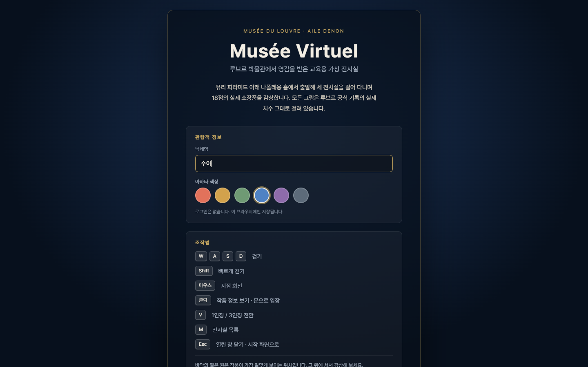
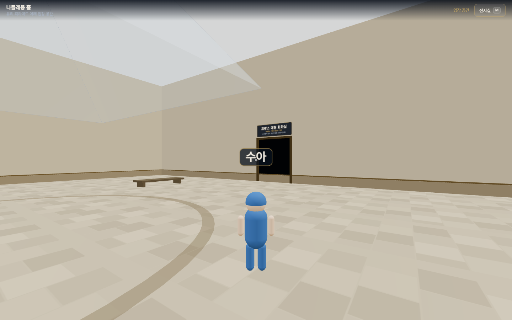
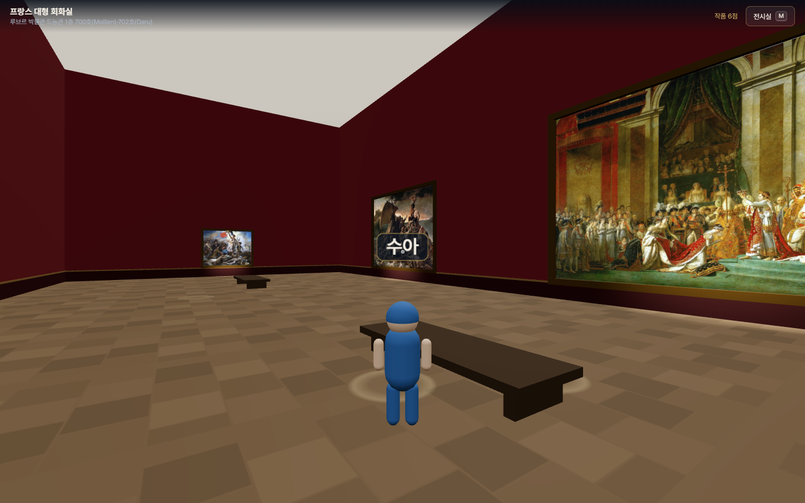
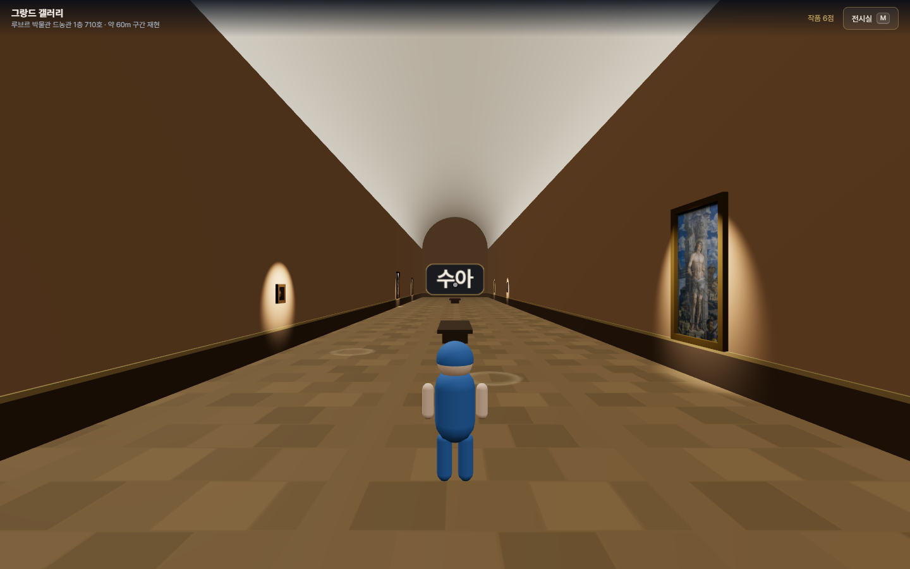
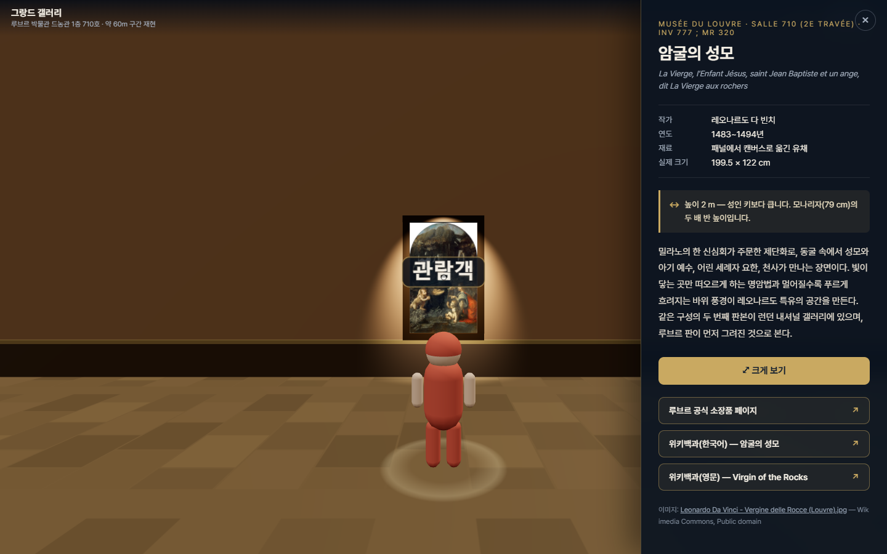
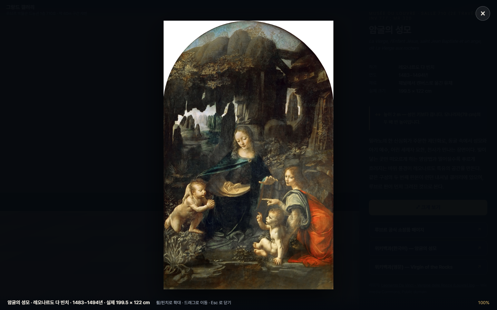
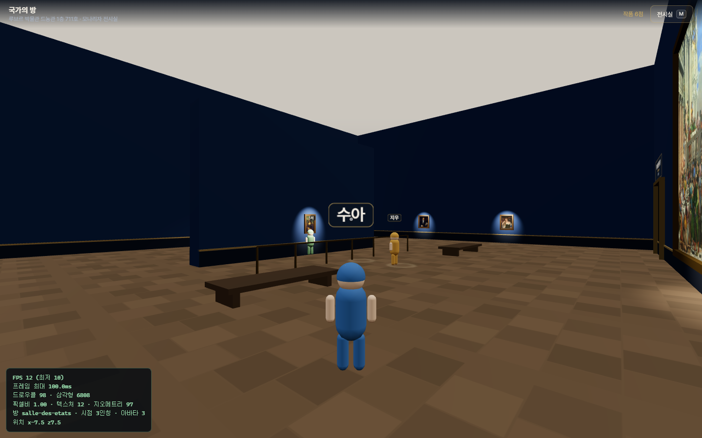

# Musée Virtuel — 루브르 교육용 가상 전시실

루브르 박물관에서 영감을 받은 1인칭/3인칭 교육용 3D 가상 미술관입니다.
유리 피라미드 아래 **나폴레옹 홀**에서 출발해 **세 전시실**을 아바타로 걸어 다니며,
실제로 루브르에 걸려 있는 **18점**을 공식 기록의 실제 치수 그대로 감상합니다.

| | |
| --- | --- |
|  |  |
|  |  |

| | |
| --- | --- |
|  |  |



- **기술**: Three.js (r180) + Vite 7 — 서버 로직·환경 변수 없는 완전 정적 사이트
- **공간**: 로비 1곳 + 전시실 3곳, 포털(문)로 이동. 주소창 `?room=` 으로 바로 입장
- **아바타**: 닉네임·색상을 고른 로우폴리 아바타. 3인칭이 기본이고 `V` 로 1인칭 전환
- **네트워크**: 이번 단계는 혼자 관람. `src/net/` 에 어댑터 인터페이스만 만들어 두었고 `?bots=3` 으로 동작을 확인할 수 있습니다

---

## 빠르게 실행하기

```bash
npm install
npm run dev          # http://localhost:5173
```

닉네임과 아바타 색을 고르고 **입장하기** 를 누르면 로비에서 관람이 시작됩니다.

### 조작

| 데스크톱 | 동작 |
| --- | --- |
| `W` `A` `S` `D` / 방향키 | 걷기 |
| `Shift` | 빠르게 걷기 |
| 마우스 | 시점 회전 |
| 클릭 | 작품 정보 보기 · 문으로 입장 |
| `V` | 1인칭 / 3인칭 전환 |
| `M` | 전시실 목록 |
| `E` | 바라보는 문으로 입장 |
| `Esc` | 열린 창 닫기 → 시작 화면 |

| 모바일 (터치 기기 자동 감지) | 동작 |
| --- | --- |
| 왼쪽 화면 드래그 | 가상 조이스틱으로 걷기 (끝까지 밀면 빠르게) |
| 오른쪽 화면 드래그 | 시점 회전 |
| 탭 | 작품 정보 보기 · 문으로 입장 |
| 우하단 **시점** 버튼 | 1인칭 / 3인칭 전환 |
| 상단 **전시실** 버튼 | 전시실 이동 |

모바일에서는 정보 패널이 **하단 시트**로 올라오고, 조준점 대신 **탭한 지점**으로 작품을 고릅니다.

### URL 파라미터

| 파라미터 | 뜻 |
| --- | --- |
| `?room=salle-des-etats` | 특정 전시실로 바로 입장 (`lobby` `salle-des-etats` `peinture-francaise` `grande-galerie`) |
| `?bots=3` | 가짜 방문자 3명 생성 (최대 12) — 네트워크 자리 테스트용 |
| `?debug` | FPS · 드로우콜 · 삼각형 · 픽셀비 · 위치 표시 |

예) <code>?room=grande-galerie&bots=5&debug</code>

### 그 밖의 명령

```bash
npm run build            # dist/ 로 정적 빌드
npm run preview          # 빌드 결과 미리보기
npm run images           # fetch-images → optimize-images 를 연달아 실행
npm run verify-links     # 외부 링크 70건이 모두 열리는지 확인
```

---

## 공간 구성

| | 공간 | 실제 루브르 | 크기(가상) | 작품 |
| --- | --- | --- | --- | --- |
| 로비 | 나폴레옹 홀 | Hall Napoléon (유리 피라미드 아래) | 32 × 32 m | — (포털 3개) |
| 전시실 1 | 국가의 방 | 드농관 1층 **711호** Salle des États | 30 × 23 m | 6점 |
| 전시실 2 | 프랑스 대형 회화실 | 드농관 1층 **700호 Mollien · 702호 Daru** | 34 × 18 m | 6점 |
| 전시실 3 | 그랑드 갤러리 | 드농관 1층 **710호** Grande Galerie | 9.6 × **60 m** | 6점 |

> **그랑드 갤러리는 일부 구간만 재현했습니다.** 실제 회랑은 길이 약 480 m 입니다.
> 이 가상 전시실은 선정 작품이 걸린 **1·2 travée 를 포함한 약 60 m 구간**만 재현한 것이며,
> 작품 순서도 실제 travée 순서(1 travée → 2 travée)를 따랐습니다.

---

## 전시 중인 작품 (18점)

18점 모두 **루브르 공식 소장품 데이터베이스의 JSON API**(`collections.louvre.fr/ark:/53355/<id>.json`)로
`room` 값을 직접 확인해 **"현재 전시 중 + 해당 전시실"** 임을 검증했습니다. 치수도 공식 기록값입니다.

### 전시실 1 — 국가의 방 (Salle 711)

| 작품 | 작가 | 제작 | 소장번호 | 전시실 | 실제 크기 |
| --- | --- | --- | --- | --- | --- |
| [모나리자](https://collections.louvre.fr/en/ark:/53355/cl010062370) | 레오나르도 다 빈치 | 1503~1519 | INV 779 ; MR 316 | Salle 711 | 79.4 × 53.4 cm |
| [가나의 혼인잔치](https://collections.louvre.fr/en/ark:/53355/cl010064382) | 파올로 베로네세 | 1562~1563 | INV 142 ; MR 384 | Salle 711 | 677 × 994 cm |
| [엠마오의 순례자](https://collections.louvre.fr/en/ark:/53355/cl010067589) | 파올로 베로네세 | 16세기 | INV 146 ; MR 385 | Salle 711 | 242 × 416 cm |
| [목욕하는 수산나](https://collections.louvre.fr/en/ark:/53355/cl010062254) | 틴토레토 | 1550~1575 | INV 568 ; MR 498 | Salle 711 | 167 × 238 cm |
| [장갑을 낀 남자](https://collections.louvre.fr/en/ark:/53355/cl010062290) | 티치아노 | 1500~1525 | INV 757 ; MR 507 | Salle 711 | 100 × 89 cm |
| [거울을 보는 여인](https://collections.louvre.fr/en/ark:/53355/cl010062292) | 티치아노 | 1525~1550 | INV 755 ; MR 504 | Salle 711 | 99 × 76 cm |

### 전시실 2 — 프랑스 대형 회화실 (Salle 700 Mollien · 702 Daru)

| 작품 | 작가 | 제작 | 소장번호 | 전시실 | 실제 크기 |
| --- | --- | --- | --- | --- | --- |
| [나폴레옹 1세의 대관식](https://collections.louvre.fr/en/ark:/53355/cl010065720) | 자크루이 다비드 | 1807 | INV 3699 ; MR 1437 | Salle 702 (Daru) | 621 × 979 cm |
| [메두사호의 뗏목](https://collections.louvre.fr/en/ark:/53355/cl010059199) | 테오도르 제리코 | 1818~1819 | INV 4884 ; C 51 | Salle 700 (Mollien) | 491 × 716 cm |
| [자파의 페스트 환자를 찾은 나폴레옹](https://collections.louvre.fr/en/ark:/53355/cl010062570) | 앙투안장 그로 | 1804 | INV 5064 ; MR 1782 | Salle 700 (Mollien) | 523 × 715 cm |
| [사르다나팔루스의 죽음](https://collections.louvre.fr/en/ark:/53355/cl010065757) | 외젠 들라크루아 | 1827 | RF 2346 | Salle 700 (Mollien) | 392 × 496 cm |
| [민중을 이끄는 자유의 여신](https://collections.louvre.fr/en/ark:/53355/cl010065872) | 외젠 들라크루아 | 1830 | RF 129 | Salle 700 (Mollien) | 260 × 325 cm |
| [사비니 여인들의 중재](https://collections.louvre.fr/en/ark:/53355/cl010065426) | 자크루이 다비드 | 1799 | INV 3691 ; L 3710 | Salle 702 (Daru) | 385 × 522 cm |

### 전시실 3 — 그랑드 갤러리 (Salle 710)

| 작품 | 작가 | 제작 | 소장번호 | 전시실 | 실제 크기 |
| --- | --- | --- | --- | --- | --- |
| [성 세바스티아누스](https://collections.louvre.fr/en/ark:/53355/cl010064796) | 안드레아 만테냐 | 1475~1500 | RF 1766 | Salle 710 (1ère travée) | 255 × 140 cm |
| [콘도티에레](https://collections.louvre.fr/en/ark:/53355/cl010065016) | 안토넬로 다 메시나 | 1475 | MI 693 | Salle 710 (1ère travée) | 36.2 × 30 cm |
| [암굴의 성모](https://collections.louvre.fr/en/ark:/53355/cl010062373) | 레오나르도 다 빈치 | 1483~1494 | INV 777 ; MR 320 | Salle 710 (2e travée) | 199.5 × 122 cm |
| [성 안나와 성 모자](https://collections.louvre.fr/en/ark:/53355/cl010066107) | 레오나르도 다 빈치 | 1503~1519 | INV 776 ; MR 319 | Salle 710 (2e travée) | 168 × 113 cm |
| [세례자 요한](https://collections.louvre.fr/en/ark:/53355/cl010062374) | 레오나르도 다 빈치 | 1508~1519 | INV 775 ; MR 318 | Salle 710 (2e travée) | 72.9 × 56.3 cm |
| [아름다운 정원사](https://collections.louvre.fr/en/ark:/53355/cl010060754) | 라파엘로 산치오 | 1507 | INV 602 ; MR 433 | Salle 710 (2e travée) | 122 × 80 cm |

### 후보였다가 제외한 작품

| 작품 | 제외 사유 (공식 기록 확인) |
| --- | --- |
| 티치아노 — 전원의 합주 (Le Concert champêtre) | **현재 비전시** (`non exposé`) |
| 베로네세 — 라 벨 나니 (La Belle Nani, RF 2111) | **루브르 아부다비** 소장 |
| 레오나르도 — 라 벨 페로니에르 (INV 778) | **현재 비전시** (`non exposé`) |
| 다비드 — 호라티우스 형제의 맹세 (RF 47) | 해당 ark 는 본작이 아니라 **밑그림**이며 `non exposé` |
| 카라바조 — 성모의 죽음 (INV 54) | 그랑드 갤러리이지만 **Salle 712**(3e travée) — 전시실 3 범위(710) 밖 |
| 라파엘로 — 발다사레 카스틸리오네 (INV 611) | **Salle 712**(Tribune) — 전시실 3 범위 밖 |
| 레오나르도 — 세례자 요한 (INV 780) | Salle 710 이지만 **17세기에 바쿠스로 개작된 다른 작품**. 대신 원작 INV 775 를 선정 |
| 제리코 — 메두사호의 뗏목 (RF 1667 / RF 2229) | 같은 제목이지만 **습작**이며 쉴리관 소장 |

---

## 외부 링크

작품마다 **루브르 공식 소장품 페이지**와 **위키백과**를 연결합니다.
한국어 개별 문서가 없는 작품은 한국어 **작가 문서**를 유지하고 **영문 작품 문서**를 덧붙였습니다.
모든 링크는 `target="_blank" rel="noopener noreferrer"` 이며, `npm run verify-links` 로 **70건 전부 HTTP 200** 을 확인합니다.

---

## 이미지 파이프라인

```
Wikimedia Commons (퍼블릭 도메인)
   │ npm run fetch-images     긴 변 ≤ 4096px JPEG · 이어받기 지원
   ▼
.cache/originals/*.jpg        (git 에 올리지 않음 · 합계 86 MB)
   │ npm run optimize-images  sharp
   ├─▶ public/images/<id>.webp        3D 텍스처 · 긴 변 2048px · q80
   └─▶ public/images/large/<id>.webp  크게 보기 뷰어 · 긴 변 ≤ 4096px · q82 · 지연 로딩
```

**텍스처 용량 상한은 전시실 단위 4 MB** 입니다. 전시실은 한 번에 하나만 로딩하므로
입장할 때 받는 양이 곧 한 방의 합계입니다. 넘으면 `optimize-images` 가 실패로 끝납니다.

| 전시실 | 작품 | 텍스처 합계 | 뷰어 합계(지연 로딩) |
| --- | ---: | ---: | ---: |
| salle-des-etats | 6 | **3.57 MB** | 16.10 MB |
| peinture-francaise | 6 | **2.49 MB** | 10.56 MB |
| grande-galerie | 6 | **1.59 MB** | 9.62 MB |

자세한 표는 [`public/images/SIZES.md`](public/images/SIZES.md), 출처·라이선스는
[`public/images/CREDITS.md`](public/images/CREDITS.md) 에 자동 기록됩니다.

---

## 폴더 구조

```
.
├─ index.html                  시작 화면 · HUD · 위치 막대 · 패널 · 뷰어 · 메뉴 · 터치 레이어
├─ vite.config.js / vercel.json
├─ docs/screenshots/
├─ public/images/              <id>.webp · large/<id>.webp · CREDITS.md · SIZES.md
├─ scripts/                    fetch-images · optimize-images · verify-links
└─ src/
   ├─ main.js                  오케스트레이터 — 상태·입력·UI·네트워크를 연결하는 유일한 지점
   ├─ style.css
   ├─ core/                    ── 상태 계층 (3D 와 무관) ──
   │  ├─ PlayerState.js        { id, name, color, roomId, position, rotation, moving }
   │  ├─ profile.js            닉네임·색상 localStorage
   │  ├─ router.js             ?room= / ?bots= / ?debug  URL 동기화
   │  └─ input.js              키보드 + 터치를 하나의 입력원으로
   ├─ data/                    ── 콘텐츠 계층 ──
   │  ├─ rooms.json            공간 치수 · 벽 · 집기 · 포털 · 조명 · 걸이/감상 규칙
   │  ├─ paintings.json        작품 메타 · 치수 · 배치 · 크기 비교 · 링크 · 출처
   │  └─ catalog.js            데이터 접근 계층 (씬·UI 는 JSON 을 직접 읽지 않는다)
   ├─ scene/                   ── 3D 계층 ──
   │  ├─ createScene.js        렌더러 · 카메라 · 성능 가드
   │  ├─ buildRoom.js          rooms.json → 바닥/천장/벽/집기/포털 + 충돌 AABB
   │  ├─ buildPaintings.js     paintings.json → 캔버스 + 액자 + 스포트 + 감상 위치 표시
   │  ├─ RoomSession.js        공간 하나를 올리고 내리는 단위 (텍스처 dispose)
   │  ├─ Avatar.js             로우폴리 아바타 — 내 것과 원격이 공유
   │  └─ PlayerController.js   이동 · 충돌 · 1인칭/3인칭 카메라
   ├─ interaction/
   │  └─ picker.js             작품 + 포털 Raycaster 판정 (중앙 / 탭 좌표)
   ├─ net/                     ── 네트워크 계층 (Phase 3 자리) ──
   │  ├─ NetworkAdapter.js     인터페이스 + 아무것도 안 하는 LocalAdapter
   │  ├─ BotAdapter.js         ?bots=N 가짜 방문자
   │  └─ RemoteAvatar.js       원격 아바타 + 보간 + 입·퇴장 관리
   └─ ui/                      ── UI 계층 ──
      ├─ startOverlay.js  infoPanel.js  imageViewer.js
      ├─ hud.js  roomMenu.js  touchControls.js  debugOverlay.js
```

### Phase 3(실시간 다중 접속)에 꽂을 자리

1. **플레이어 상태는 한 객체** — `core/PlayerState.js` 의 `{ id, name, color, roomId, position, rotation, moving }`.
   `toSnapshot()` / `applySnapshot()` 이 그대로 전송 형식입니다.
2. **네트워크는 어댑터 하나** — `net/NetworkAdapter.js` 의 네 메서드
   (`connect` / `sendState` / `onPlayersUpdate` / `disconnect`)만 구현하면 됩니다.
   `main.js` 에서 바꾸는 줄은 **한 줄**입니다:

   ```js
   const net = route.bots > 0 ? new BotAdapter(route.bots) : new LocalAdapter();
   //                                                     ↑ 여기를 실시간 구현으로
   ```

3. **아바타 렌더링은 공용** — 내 아바타(`PlayerController.avatar`)와 원격 아바타(`RemoteAvatar.avatar`)가
   **같은 `Avatar` 클래스**를 씁니다. 검증 스크립트에서 두 인스턴스의 생성자가 같은지 확인합니다.
4. **전송 주기도 이미 분리** — `main.js` 의 `NET_SEND_INTERVAL`(초당 12회)에 맞춰
   `net.sendState(player.toSnapshot())` 를 이미 호출하고 있습니다. LocalAdapter 가 버릴 뿐입니다.
5. **원격 아바타 보간·입퇴장** — `RemoteAvatarGroup.sync(players, roomId)` 가
   같은 방에 있는 사람만 씬에 올리고, 사라진 사람은 해제합니다.
6. **가짜 방문자로 미리 확인** — `?bots=3` 은 실제 어댑터와 **똑같은 인터페이스**로 동작하므로,
   실시간 구현을 끼워도 화면 코드는 그대로입니다.

---

## 작품·전시실 추가하기

### 작품 추가

1. **소재 확인** — 공식 JSON API 로 `room` 과 `dimension` 을 직접 확인합니다.

   ```bash
   curl -s "https://collections.louvre.fr/ark:/53355/<ark-id>.json" \
     | node -e "const d=JSON.parse(require('fs').readFileSync(0));console.log(d.title,'|',d.room,'|',JSON.stringify(d.dimension))"
   ```

   `room` 이 비어 있고 `currentLocation` 이 `non exposé` 면 **현재 비전시**이므로 넣지 않습니다.

2. **이미지** — `scripts/fetch-images.mjs` 의 `TARGETS` 에 `{ id, commonsFile }` 한 줄을 더하고 `npm run images`.
3. **데이터** — `src/data/paintings.json` 에 항목 추가. `room` 에 전시실 id, `louvreRoom` 에 실제 전시실 번호를 적습니다.
4. **확인** — `npm run verify-links` 와 `npm run dev`.

`placement` 읽는 법은 아래와 같습니다. 걸이 높이와 감상 위치는 적지 않으면 규칙대로 자동 계산됩니다.

| 키 | 의미 |
| --- | --- |
| `wall` | 걸 벽의 `id` |
| `face` | `axis:"x"` 벽은 `+`가 +Z쪽, `axis:"z"` 벽은 `+`가 +X쪽 |
| `offset` | 벽 중앙에서 벽이 뻗은 축을 따라 이동한 거리(m) |
| `centerHeight` | *(선택)* 걸이 높이 직접 지정 |
| `viewFrom` | *(선택)* 감상 위치까지의 거리(m) |

**걸이 규칙** — 세로 **150 cm 초과** 대형 작품은 **하단을 바닥에서 0.8 m**, 그 외는 **중심을 1.6 m**.

### 전시실 추가

`src/data/rooms.json` 의 `rooms` 에 공간을 더하고, 로비의 `portals` 에 한 줄을 추가하면 끝입니다.
전시실 목록 메뉴와 `?room=` 라우팅은 `catalog.listRooms()` 를 쓰므로 자동으로 반영됩니다.

---

## 결정 사항

판단이 필요했던 부분과 그 근거입니다.

### 1. 전시실 2 는 실제로 두 방(700·702)을 합친 것

요청하신 세 작품(「메두사호의 뗏목」·「민중을 이끄는 자유의 여신」·「나폴레옹 대관식」)은 공식 기록상
**같은 방에 있지 않습니다.** 앞의 둘은 **700호 Mollien(낭만주의)**, 대관식은 **702호 Daru(신고전주의)** 입니다.
두 방은 드농관 1층에 나란히 붙은 대형 프랑스 회화 전시실이므로, **하나의 가상 전시실로 합치고**
각 작품의 정보 패널과 README 표에 **실제 전시실 번호를 그대로 표기**했습니다.
전시실 소개문에도 합쳤다는 사실을 적어 두었습니다.

### 2. 「세례자 요한」은 INV 775 로 교체

검색으로 먼저 찾은 INV 780 은 Salle 710 에 있지만, 공식 기록의 비고가
`transformé en Bacchus au XVIIe siècle`(17세기에 바쿠스로 개작)이고 치수도 177 × 115 cm 로
널리 알려진 「세례자 요한」(72.9 × 56.3 cm)과 다릅니다. **서로 다른 작품**이므로,
같은 Salle 710 에 있는 원작 **INV 775** 로 교체했습니다.

### 3. 「성 안나와 성 모자」의 치수 표기

루브르 공식 기록은 **168 × 113 cm** 입니다. 다만 널리 인용되는 치수(168 × 130 cm)나
Commons 이미지의 가로세로 비율과는 약 10% 차이가 있습니다.
본 프로젝트의 기준은 **공식 기록**이므로 113 cm 로 걸되, 이미지가 눌려 보일 수 있습니다.
개발 모드에서 이미지 비율이 공식 치수와 8% 넘게 다르면 콘솔에 경고를 띄우도록 해 두었습니다(`buildPaintings.js`).

### 4. 그랑드 갤러리는 60 m 구간만

실제 회랑은 약 480 m 입니다. 전부 재현하면 걸어서 건너는 데만 몇 분이 걸리고
빈 벽이 대부분이어서, **선정 작품이 있는 1·2 travée 중심 60 m 구간**만 재현했습니다.
작품을 travée 순서대로 배치해 실제 동선의 느낌은 남겼습니다.

### 5. 로비는 "영감을 받은" 공간

나폴레옹 홀의 실제 도면을 재현하지 않고, **유리 피라미드 천창 · 원형 바닥 문양 · 세 방향의 문**
이라는 특징만 추려 32 × 32 m 정사각 홀로 단순화했습니다. 로비는 작품이 없는 길목이므로
정확도보다 **어디로 가야 하는지 한눈에 보이는 것**을 우선했습니다.

### 6. 포털은 "클릭/탭"으로 입장

문 가까이 가면 자동으로 넘어가게 하면, 벽을 따라 걷다가 의도치 않게 이동하는 일이 생깁니다.
**바라보면 안내가 뜨고, 클릭(또는 `E`, 모바일은 탭)해야 이동**하도록 했습니다.

### 7. 방을 옮길 때 이전 방을 "나중에" 해제

새 방을 먼저 다 만든 뒤 이전 방을 `dispose()` 합니다. 반대로 하면 로딩 중 화면이 비기 때문입니다.
메모리는 잠깐 두 방 분량이 되지만, 전시실 하나가 2~4 MB 라서 문제가 되지 않습니다.
검증 스크립트에서 **세 방을 세 바퀴 돈 뒤 텍스처·지오메트리 수가 그대로인지** 확인합니다(증가 0).

### 8. 3인칭 카메라는 아바타를 "쳐다보지" 않는다

처음에는 카메라가 아바타를 바라보도록(`lookAt(player)`) 만들었는데, 그러면 **화면 한가운데 조준점이
아바타의 몸통을 가리켜** 작품을 조준할 수 없었습니다(검증에서 Raycaster 적중 0건).
지금은 카메라를 시선 축 위 뒤쪽에 두고 **회전은 1인칭과 똑같이 `(pitch, yaw)`** 로 둡니다.
덕분에 조준점이 1인칭·3인칭에서 동일하게 "바라보는 곳"을 가리키고, 아바타는 화면 아래쪽에 보입니다.

벽에 파묻히는 문제는 몸에서 카메라 자리까지 광선을 쏘아 막히면 그만큼 앞으로 당겨(최소 0.9 m) 해결합니다.

### 9. 작품을 고르면 카메라가 정면으로 이동

작품을 비스듬히 보면서 설명을 읽으면 그림이 찌그러져 보입니다.
선택하는 순간 **그 작품의 감상 위치로 이동해 정면을 보도록** 했습니다.
3인칭에서는 카메라 위치가 `pitch` 에 따라 달라지므로 두 번 반복해 수렴시킵니다.
(검증: 카메라 시선과 작품 방향의 내적 **1.000**)

### 10. 폰트는 CDN(Pretendard 동적 서브셋)

한글 웹폰트를 자체 호스팅하면 저장소에 수 MB 가 추가됩니다. jsDelivr 의 동적 서브셋 CSS 를 쓰고,
받지 못하는 환경에서는 `Noto Sans KR` → 시스템 한글 폰트로 떨어지도록 CSS 스택을 구성했습니다.
아바타 이름표와 포털 안내판도 같은 폰트를 캔버스에 그립니다.

### 11. 성능

그림자 비활성화, 후처리 없음, 작품 캔버스는 조명 계산이 없는 `MeshBasicMaterial`.
`?bots=3` 을 켠 국가의 방 기준 **드로우콜 98 · 삼각형 6,808 · 광원 9** 로 가볍습니다.
여기에 더해 2초마다 프레임레이트를 보고 55fps 미만이면 픽셀 비율을 2 → 1.5 → 1 로 낮춥니다.

> 검증은 헤드리스 Chrome + 소프트웨어 렌더러(SwiftShader)에서 했으므로
> **실제 GPU 의 프레임레이트를 측정한 값이 아닙니다.** 실측은 `?debug` 로 확인하세요.

### 12. Vercel 배포는 계속 보류

요청대로 배포하지 않았습니다. `vercel.json` 은 작성되어 있어 필요해지면 바로 올릴 수 있습니다.

---

## 라이선스

코드는 자유롭게 사용하셔도 됩니다. 작품 이미지는 각 파일의 퍼블릭 도메인 조건을 따르며,
출처 표기는 [`public/images/CREDITS.md`](public/images/CREDITS.md) 를 참고하세요.
작품 정보·치수·소재는 루브르 박물관 공식 소장품 데이터베이스(collections.louvre.fr)에서 확인했습니다.
