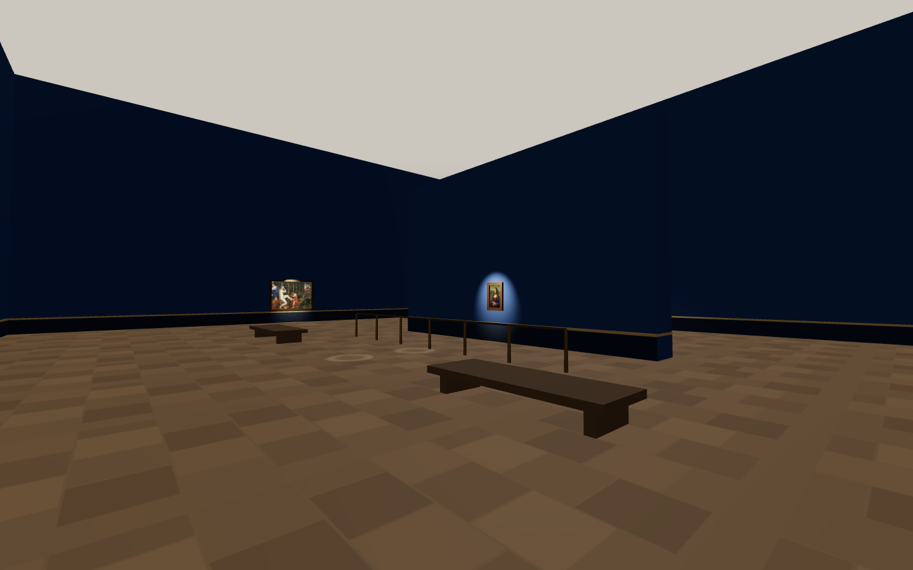
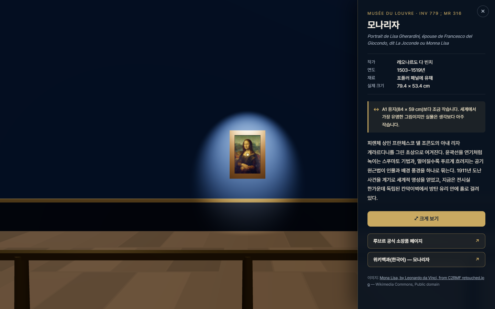
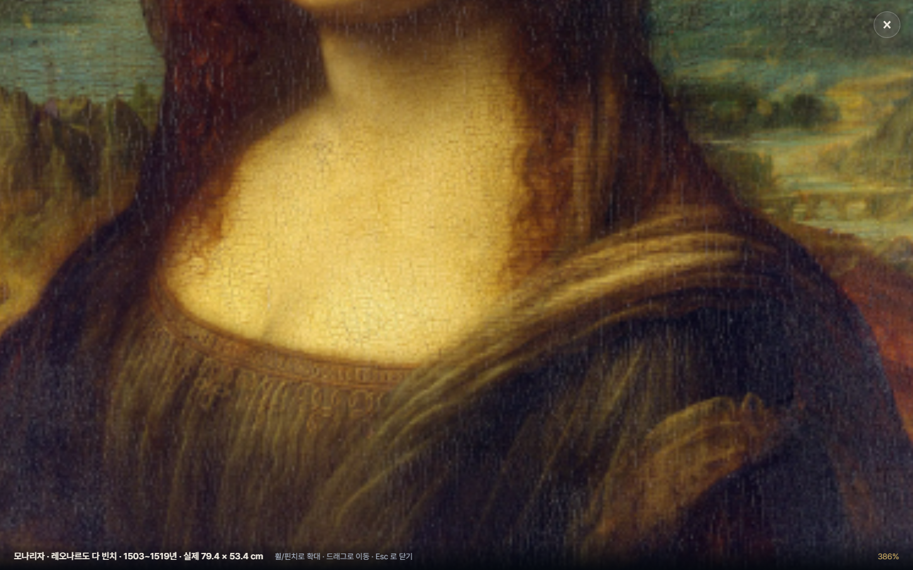

# Salle des États — 교육용 가상 전시실

루브르 박물관 **드농관 1층 711호 Salle des États(모나리자 전시실)** 에서 영감을 받은 1인칭 교육용 3D 전시실입니다.
WASD + 마우스로 걸어 다니며 작품을 감상하고, 그림을 클릭하면 작품 정보·크기 비교·외부 학습 링크가 뜹니다.
실물 크기 그대로 걸린 그림을 자세히 보고 싶으면 **크게 보기** 로 고해상도 전체 화면 뷰어를 열 수 있습니다.

| | |
| --- | --- |
|  |  |
|  |  |

- **기술**: Three.js (r180) + Vite 7 — 서버 로직·환경 변수 없는 완전 정적 사이트
- **작품**: 실제로 Salle 711 에 걸려 있는 6점 (루브르 공식 소장품 DB 로 소재 확인)
- **크기**: 모든 그림은 루브르 공식 기록의 실제 치수(cm)를 그대로 환산해 배치 — 「가나의 혼인잔치」(677 × 994 cm) 와 「모나리자」(79.4 × 53.4 cm) 의 압도적인 크기 차이가 그대로 드러납니다.

---

## 빠르게 실행하기

```bash
npm install
npm run dev          # http://localhost:5173
```

이미지 로딩 진행률이 0% → 100% 로 올라간 뒤 **입장하기** 를 누르면 마우스 포인터가 잠기고 관람이 시작됩니다.

| 조작 | 동작 |
| --- | --- |
| `W` `A` `S` `D` (또는 방향키) | 걷기 |
| `Shift` | 빠르게 걷기 |
| 마우스 | 시점 회전 |
| 클릭 | 조준점에 들어온 그림의 정보 패널 열기 (이때 포인터 잠금이 풀려 링크를 바로 클릭할 수 있음) |
| 패널을 닫은 뒤 화면 클릭 | 다시 관람 모드로 (포인터 재잠금) |
| `Esc` | 열려 있는 것부터 차례로 닫기 — 뷰어 → 정보 패널 → 시작 화면 |

뷰어 안에서는 **휠/핀치로 확대**, **드래그로 이동**, **더블클릭으로 확대 토글**, `Esc` 또는 `×` 로 닫습니다.

바닥의 옅은 원은 **감상 위치 표시**입니다. 작품 크기에 맞춰 "여기쯤 서면 알맞게 보입니다" 를 알려 주며,
큰 그림일수록 멀리 찍힙니다(「가나의 혼인잔치」 8 m, 「장갑을 낀 남자」 2 m).

### 그 밖의 명령

```bash
npm run build            # dist/ 로 정적 빌드
npm run preview          # 빌드 결과 미리보기
npm run images           # 아래 두 단계를 연달아 실행
npm run fetch-images     #   1단계: Commons 원본 → .cache/originals/ (+ CREDITS.md)
npm run optimize-images  #   2단계: 원본 → public/images 의 WebP 두 벌 (+ SIZES.md)
npm run verify-links     # 모든 외부 링크(루브르·위키백과·이미지 출처)가 열리는지 확인
```

---

## 전시 중인 작품

6점 모두 루브르 공식 소장품 데이터베이스에서 소재가 **"Salle 711 — Salle de la Joconde (Salle des États), Aile Denon, Niveau 1"** 로 확인된 작품입니다.

| 작품 | 작가 | 제작 | 실제 크기 (세로 × 가로) | 소장품 번호 | 걸이 규칙 |
| --- | --- | --- | --- | --- | --- |
| [모나리자](https://collections.louvre.fr/en/ark:/53355/cl010062370) | 레오나르도 다 빈치 | 1503~1519 | 79.4 × 53.4 cm | INV 779 | 중심 1.6 m |
| [가나의 혼인잔치](https://collections.louvre.fr/en/ark:/53355/cl010064382) | 파올로 베로네세 | 1562~1563 | 677 × 994 cm | INV 142 | 하단 0.8 m |
| [엠마오의 순례자](https://collections.louvre.fr/en/ark:/53355/cl010067589) | 파올로 베로네세 | 16세기 | 242 × 416 cm | INV 146 | 하단 0.8 m |
| [목욕하는 수산나](https://collections.louvre.fr/en/ark:/53355/cl010062254) | 틴토레토 | 1550~1575 | 167 × 238 cm | INV 568 | 하단 0.8 m |
| [장갑을 낀 남자](https://collections.louvre.fr/en/ark:/53355/cl010062290) | 티치아노 | 1500~1525 | 100 × 89 cm | INV 757 | 중심 1.6 m |
| [거울을 보는 여인](https://collections.louvre.fr/en/ark:/53355/cl010062292) | 티치아노 | 1525~1550 | 99 × 76 cm | INV 755 | 중심 1.6 m |

전시실 배치도 실제를 따랐습니다. 모나리자는 방 한가운데 독립 칸막이벽(cimaise)에,
「가나의 혼인잔치」는 그 **정면** 벽에 마주 걸려 있습니다.

### 외부 링크 구성

| 작품 | 루브르 | 위키백과(한국어) | 위키백과(영문) |
| --- | --- | --- | --- |
| 모나리자 | ✓ | 모나리자 | — |
| 가나의 혼인잔치 | ✓ | 가나의 혼인잔치 | — |
| 엠마오의 순례자 | ✓ | 작가(파올로 베로네세) | Supper at Emmaus (Veronese) |
| 목욕하는 수산나 | ✓ | 작가(틴토레토) | 작가(Tintoretto) |
| 장갑을 낀 남자 | ✓ | 작가(티치아노) | Man with a Glove |
| 거울을 보는 여인 | ✓ | 작가(티치아노) | Woman with a Mirror |

모든 링크는 `target="_blank" rel="noopener noreferrer"` 이며, `npm run verify-links` 로 전부 HTTP 200 을 확인합니다.

---

## 이미지 파이프라인

```
Wikimedia Commons                           (퍼블릭 도메인 원본)
        │  npm run fetch-images   긴 변 ≤ 4096px JPEG
        ▼
.cache/originals/*.jpg                      (git 에 올리지 않음)
        │  npm run optimize-images   sharp
        ├──▶ public/images/<id>.webp         3D 텍스처 · 긴 변 2048px · q80 · 합계 3.57 MB
        └──▶ public/images/large/<id>.webp   크게 보기 뷰어 · 긴 변 ≤ 4096px · q82 · 지연 로딩
```

- **3D 텍스처는 합계 4 MB 상한**을 둡니다. 넘으면 `optimize-images` 가 실패로 끝납니다.
- **뷰어용 이미지는 "크게 보기" 를 누른 순간 처음 요청**됩니다. 첫 화면 로딩 시간에 영향을 주지 않으므로 용량 상한이 없습니다.
- 변환 결과표는 [`public/images/SIZES.md`](public/images/SIZES.md), 파일별 출처·작성자·라이선스는 [`public/images/CREDITS.md`](public/images/CREDITS.md) 에 자동 기록됩니다. 각 작품의 정보 패널 하단에도 출처·라이선스가 표시됩니다.

---

## 폴더 구조

```
.
├─ index.html                  시작 화면 · HUD · 정보 패널 · 뷰어 마크업
├─ vite.config.js
├─ vercel.json                 Vercel 설정 (배포는 아직 하지 않음)
├─ docs/screenshots/           README 용 캡처
├─ public/
│  ├─ favicon.svg
│  └─ images/
│     ├─ <id>.webp             3D 텍스처 (2048px)
│     ├─ large/<id>.webp       뷰어용 (4096px, 지연 로딩)
│     ├─ CREDITS.md            출처·작성자·라이선스
│     └─ SIZES.md              변환 결과표
├─ scripts/
│  ├─ fetch-images.mjs         Commons API → .cache/originals
│  ├─ optimize-images.mjs      sharp → WebP 두 벌 + 용량 상한 검사
│  └─ verify-links.mjs         외부 링크 상태 검사
└─ src/
   ├─ main.js                  부트스트랩 · 입력/상태 연결 · 렌더 루프
   ├─ style.css
   ├─ data/                    ── 콘텐츠 계층 ──
   │  ├─ rooms.json            방 치수 · 벽 · 집기 · 조명 · 걸이 규칙 · 감상 위치 규칙
   │  ├─ paintings.json        작품 메타 · 치수 · 배치 · 크기 비교 · 링크 · 출처
   │  └─ catalog.js            데이터 접근 계층 (씬·UI 는 JSON 을 직접 읽지 않는다)
   ├─ scene/                   ── 3D 계층 ──
   │  ├─ createScene.js        렌더러 · 카메라 · 전역 조명 · 성능 가드
   │  ├─ buildRoom.js          rooms.json → 바닥/천장/벽/집기 + 충돌 AABB
   │  ├─ buildPaintings.js     paintings.json → 캔버스 + 액자 + 스포트 조명 + 감상 위치 표시
   │  └─ PlayerControls.js     PointerLockControls + WASD + 벽 충돌
   ├─ interaction/
   │  └─ picker.js             화면 중앙 Raycaster 판정
   └─ ui/                      ── UI 계층 ──
      ├─ startOverlay.js       시작 화면 + 로딩 진행률
      ├─ infoPanel.js          우측 정보 패널
      ├─ imageViewer.js        크게 보기 전체 화면 뷰어
      └─ hud.js                조준점 + 호버 라벨
```

### 계층 경계 (다음 단계 대비)

다음 단계에서 **로비 + 여러 전시실 / 3인칭 아바타 / 실시간 동기화** 로 확장할 것을 전제로,
다음 경계를 지키도록 정리해 두었습니다.

- `src/data/catalog.js` 가 **유일한 데이터 입구**입니다. 씬·UI 코드는 `rooms.json` / `paintings.json` 을 직접 import 하지 않습니다.
  데이터가 서버/DB 로 옮겨가도 `listRooms()` `getRoom(id)` `getPaintings(roomId)` 시그니처만 유지하면 됩니다.
- `listRooms()` 는 이미 **목록**을 돌려줍니다. 전시실을 추가하면 로비 화면은 이 함수만 쓰면 됩니다.
- `scene/` 모듈은 모두 `(데이터) → (THREE.Group, 충돌 박스, 클릭 대상)` 형태의 순수 빌더입니다.
  전시실을 바꿀 때 씬 그래프에서 이전 그룹을 떼고 새 그룹을 붙이면 됩니다.
- 조작(`PlayerControls`)은 카메라와 충돌 박스 배열에만 의존합니다. 3인칭으로 바꿀 때 카메라 리그만 교체하면 됩니다.
- UI 모듈은 모두 `{ show, close, isOpen }` 형태의 작은 객체를 돌려주며 서로를 모릅니다. 연결은 `main.js` 한 곳에서만 합니다.

### 설계 메모

- **작품 캔버스는 `MeshBasicMaterial`** 로 그립니다. 조명 세기와 무관하게 원화의 색이 그대로 보이도록 한 선택이며, 스포트 조명은 벽·액자에만 영향을 줘 분위기를 담당합니다.
- **충돌 판정은 AABB** 입니다. X축과 Z축을 나눠 해결하기 때문에 벽에 비스듬히 부딪히면 벽을 따라 미끄러집니다.
- **그림자는 비활성화**(`renderer.shadowMap.enabled = false`)입니다. 스포트 조명 6개를 켜도 추가 렌더 패스가 생기지 않습니다.

---

## 작품 추가하기

### 1. 작품이 실제로 이 방에 있는지 확인

[collections.louvre.fr](https://collections.louvre.fr/) 에서 작품을 찾은 뒤, 상세 페이지의 **소재(Location)** 가
`Salle 711` 인지 확인합니다. JSON API 로 바로 확인할 수도 있습니다.

```bash
curl -s "https://collections.louvre.fr/ark:/53355/<ark-id>.json" \
  | node -e "const d=JSON.parse(require('fs').readFileSync(0));console.log(d.title,'|',d.room,'|',JSON.stringify(d.dimension))"
```

`room` 값과 `dimension`(Hauteur = 세로, Largeur = 가로, 단위 m)을 그대로 받아 적으면 됩니다.

### 2. 이미지 내려받기 + 변환

`scripts/fetch-images.mjs` 의 `TARGETS` 배열에 한 줄을 추가하고 `npm run images` 를 실행합니다.
Commons 파일명은 반드시 **퍼블릭 도메인** 파일이어야 합니다.

```js
const TARGETS = [
  // ...
  { id: 'my-painting', commonsFile: 'Some Public Domain File.jpg' },
];
```

```bash
npm run images   # public/images/my-painting.webp + large/my-painting.webp + CREDITS.md·SIZES.md 갱신
```

### 3. `src/data/paintings.json` 에 항목 추가

```jsonc
{
  "id": "my-painting",
  "room": "salle-des-etats",
  "titleKo": "작품 제목",
  "titleOriginal": "원어 제목",
  "artistKo": "작가",
  "artistOriginal": "Artist",
  "yearLabel": "1550~1560년",
  "mediumKo": "캔버스에 유채",
  "inventory": "INV 000",
  "size": { "heightCm": 120, "widthCm": 95 },   // 루브르 공식 기록값 (m → cm)
  "scaleNote": "A0 용지보다 조금 큽니다.",       // 정보 패널의 크기 비교 문구
  "description": "2~3문장 설명.",
  "image": "images/my-painting.webp",
  "imageLarge": "images/large/my-painting.webp",
  "frame": { "color": "#4a3317", "width": 0.1, "depth": 0.08 },
  "placement": { "wall": "west", "face": "+", "offset": 4.5 },
  "credit": { "source": "Wikimedia Commons", "file": "...", "fileUrl": "...", "license": "Public domain" },
  "links": [
    { "type": "louvre",       "label": "루브르 공식 소장품 페이지", "url": "https://collections.louvre.fr/en/ark:/53355/..." },
    { "type": "wikipedia-ko", "label": "위키백과(한국어) — 제목",  "url": "https://ko.wikipedia.org/wiki/..." },
    { "type": "wikipedia-en", "label": "위키백과(영문) — Title",   "url": "https://en.wikipedia.org/wiki/..." }
  ]
}
```

**`placement` 읽는 법** — `rooms.json` 의 `walls[]` 를 가리킵니다.

| 키 | 의미 |
| --- | --- |
| `wall` | 걸 벽의 `id` (`south` `north` `west` `east` `partition`) |
| `face` | 벽의 어느 면인가. `axis:"x"` 벽은 `+`가 +Z쪽, `axis:"z"` 벽은 `+`가 +X쪽 |
| `offset` | 벽 중앙에서 벽이 뻗은 축을 따라 이동한 거리(m). `axis:"x"` 는 X, `axis:"z"` 는 Z 방향 |
| `centerHeight` | *(선택)* 걸이 높이를 직접 지정. 없으면 `rooms.json` 의 `hangingRule` 로 자동 계산 |
| `viewFrom` | *(선택)* 감상 위치까지의 거리(m). 없으면 `viewingSpot` 규칙으로 자동 계산 |

**걸이 높이 규칙** (`rooms.json` 의 `hangingRule`) — 세로 **150 cm 초과** 대형 작품은 **하단을 바닥에서 0.8 m**,
그 외에는 **중심을 1.6 m**(눈높이)에 맞춥니다. 직접 지정하고 싶을 때만 `centerHeight` 를 적으면 됩니다.

겹치지 않게 두려면 이웃 작품과의 `offset` 차이를 두 그림의 가로폭 절반 합보다 크게 잡으면 됩니다.

### 4. 확인

```bash
npm run verify-links   # 새로 넣은 링크가 실제로 열리는지
npm run dev            # 눈으로 배치 확인
```

### 벽을 새로 만들고 싶다면

`src/data/rooms.json` 의 `walls` 에 항목을 더합니다. `axis` 는 벽이 뻗은 방향, `center` 는 `[x, z]`,
`length` 는 뻗은 길이, `thickness` 는 두께입니다. 추가한 벽은 자동으로 충돌 박스가 되고
`faces` 에 적은 면에 그림을 걸 수 있습니다.

---

## 결정 사항

작업하면서 판단이 필요했던 부분과 그 근거입니다.

### 1. 한국어 위키백과에 개별 문서가 없는 작품의 링크

6점 중 **「모나리자」와 「가나의 혼인잔치」만** 한국어 위키백과에 개별 문서가 있습니다(MediaWiki API 로 확인).
나머지 4점은 **작가 문서**(한국어)를 유지하고, 작품별 **영문 위키백과** 링크를 덧붙였습니다.
라벨에 `(작가)` / `(영문)` 을 명시해 무엇으로 연결되는지 먼저 알 수 있게 했습니다.

### 2. 「목욕하는 수산나」의 영문 링크만 작가 문서인 이유

영문 위키백과의 `Susanna and the Elders (Tintoretto)` 문서는 본문에서 **빈 미술사박물관 소장본(c. 1555–56)** 을
다루고 있고, 루브르본(INV 568)은 "같은 주제의 여러 점 중 하나" 로만 언급합니다.
이 문서를 작품 링크로 걸면 다른 그림을 설명하는 셈이 되므로, 영문도 **작가 문서(Tintoretto)** 로 연결하고
라벨을 `위키백과(영문·작가)` 로 구분했습니다. 나중에 루브르본 문서가 생기면 `paintings.json` 의 `links` 한 줄만 고치면 됩니다.

### 3. 작품 선정에서 제외한 후보

- `티치아노 – 전원의 합주(Le Concert champêtre)` — 루브르 공식 기록상 **현재 비전시**
- `베로네세 – 라 벨 나니(La Belle Nani)` — **루브르 아부다비** 소재

### 4. 뷰어용 이미지의 실제 긴 변

목표는 4096px 이지만, Commons 가 요청한 폭에 가장 가까운 캐시 썸네일을 돌려주는 경우가 있어
일부는 3840px 로 저장됩니다(「가나의 혼인잔치」 3840×2571 등). **업스케일은 하지 않습니다** —
원본이 4096px 보다 작으면(「장갑을 낀 남자」 2517×2824) 그대로 둡니다.

### 5. 폰트는 CDN(Pretendard 동적 서브셋)

한글 웹폰트를 자체 호스팅하면 저장소에 수 MB 가 추가됩니다. 정적 사이트의 저장소를 가볍게 유지하려고
jsDelivr 의 Pretendard 동적 서브셋 CSS 를 쓰고, 받지 못하는 환경에서는 `Noto Sans KR` → 시스템 한글 폰트로
떨어지도록 CSS 스택을 구성했습니다. 폐쇄망 배포가 필요하면 `npm i pretendard` 로 자체 호스팅하면 됩니다.

### 6. 60fps 를 위해 택한 것

그림자를 완전히 끄고(`shadowMap.enabled = false`), 후처리를 쓰지 않으며, 작품 캔버스는 조명 계산이 없는
`MeshBasicMaterial` 로 그립니다. 현재 씬은 **드로우콜 42회 · 삼각형 676개 · 광원 9개** 로 매우 가볍습니다.
여기에 더해 `createScene.js` 의 성능 가드가 2초마다 프레임레이트를 보고 55fps 미만이면
픽셀 비율을 2 → 1.5 → 1 로 한 단계씩 낮춥니다(한 번 내려가면 다시 올리지 않아 널뛰지 않습니다).

> 참고: 검증은 헤드리스 Chrome + 소프트웨어 렌더러(SwiftShader) 환경에서 했기 때문에
> **실제 노트북 GPU 에서의 프레임레이트를 측정한 값은 아닙니다.** 위 수치는 렌더 부하의 지표입니다.

### 7. 감상 위치 표시 거리

기본값은 `작품 높이 × 1.6` 을 2~8 m 로 제한한 값입니다. 다만 모나리자는 이 규칙대로면 2 m 가 되어
**차단봉 안쪽(접근 불가 구역)** 에 표시가 찍힙니다. 실제 전시실에도 차단봉이 있으므로
모나리자만 `viewFrom: 3.5` 로 직접 지정해 차단봉 바로 앞에 오도록 했습니다.

### 8. Vercel 배포는 보류

요청대로 배포하지 않았습니다. `vercel.json`(framework·build·outputDirectory + 이미지 캐시 헤더)은
이미 작성되어 있어, 배포가 필요해지면 `vercel --prod` 또는 대시보드 Import 만 하면 됩니다.

---

## 라이선스

코드는 자유롭게 사용하셔도 됩니다. 작품 이미지는 각 파일의 퍼블릭 도메인 조건을 따르며,
출처 표기는 [`public/images/CREDITS.md`](public/images/CREDITS.md) 를 참고하세요.
작품 정보·치수·소재는 루브르 박물관 공식 소장품 데이터베이스(collections.louvre.fr)에서 확인했습니다.
